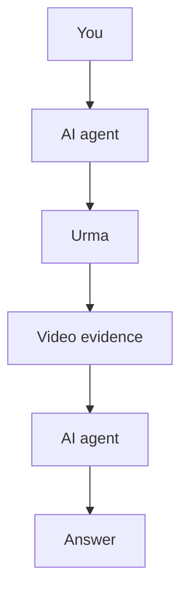

# Urma

<div align="center">
  
  <br /><br />
  <strong>Let your AI agent look inside videos.</strong>
  <br /><br />
  <a href="#example">Example</a> ·
  <a href="#quick-start">Quick start</a> ·
  <a href="#configuration">Configuration</a> ·
  <a href="#supported-sources-and-limitations">Supported sources</a>
  <br /><br />
  <sub><code>urma-mcp</code> · Model Context Protocol</sub>
</div>

Urma is a local **Model Context Protocol (MCP) server for video inspection**.
It gives AI agents captions and timestamped images from public video URLs and
local files. Your agent interprets the evidence and answers your question.

- Find words or phrases in existing captions and read the surrounding context.
- Browse visual overviews or retrieve frames at specific times and intervals.
- Narrow gaps in sampled coverage, find visual changes, and inspect cropped regions.
- Compare frames with change hints, coordinate rulers, and optional image grouping.

Urma exposes five tools. See the [tool reference](https://github.com/sajidurdev/urma/blob/main/docs/TOOLS.md)
for their parameters, results, and evidence guarantees.

## Example

Give your connected agent a public software walkthrough URL, then ask:

> Find where the presenter discusses dark mode. Is the setting enabled
> on screen afterward? Check the captions and frames, and include timestamps.

For a video with captions, the agent can open it with `inspect_video`, locate
“dark mode” with `search_transcript`, and compare nearby images with `get_frames`.
The answer can distinguish what the presenter said from what was visible.



## Quick start

You need:

- Native Node.js **22.16+ (22.x), 24.x, or 26.x**, with npm/npx.
- Windows 10 22H2 or later, macOS, or Linux with glibc; x64 or arm64.
- A user-owned local installation directory with at least **1 GiB free**.
- An MCP client that starts local servers over standard input/output (stdio).
  Visual questions also require a client and model that can read tool images.

1. In your terminal, install Urma. You don't need to clone the repository.

   ```sh
   npx -y urma-mcp@latest setup
   ```

   Setup installs and verifies Urma, FFmpeg, ffprobe, and yt-dlp. It prints the
   **Node executable** and **launcher** paths needed by your client.

2. In your MCP client's configuration, add a local server. For clients using
   `mcpServers` JSON, merge this entry into the existing configuration:

   ```json
   {
     "mcpServers": {
       "urma": {
         "command": "/absolute/path/to/node",
         "args": ["/absolute/path/to/Urma/launcher-v1.mjs"],
         "env": {
           "URMA_DATA_DIR": "/absolute/path/to/Urma"
         }
       }
     }
   }
   ```

   Replace `command` and the launcher argument with the paths printed by setup.
   Set `URMA_DATA_DIR` to the folder containing the launcher. On Windows, escape
   backslashes in JSON, for example `C:\\Users\\you\\AppData\\Local\\Urma`.
   For other configuration formats, enter the same command, argument, and
   environment variable in a local stdio server entry. Your client's documentation
   identifies its configuration location.

3. Save the configuration and restart your client. Check that it lists
   `inspect_video`, `search_transcript`, `read_transcript`, `get_overview`, and `get_frames`.
4. Give your agent a public video URL and a question, such as the [example](#example).
   For a local file, [allow its folder](#local-videos) first.

`@latest` selects the newest published npm release. See
[GitHub Releases](https://github.com/sajidurdev/urma/releases) and
[npm versions](https://www.npmjs.com/package/urma-mcp?activeTab=versions) for
published versions.

### Optional JSON registration

Setup can write the client entry instead of configuring it manually. Replace
this placeholder with the absolute path to your client's actual JSON file:

```sh
npx -y urma-mcp@latest setup --client generic --config "/absolute/path/to/mcp.json"
```

Setup preserves unrelated entries and updates Urma's command, arguments, and
`env.URMA_DATA_DIR`. Restart the client afterward. A registration failure is
reported separately from installation; a healthy runtime can still be connected
manually.

## Configuration

Set environment variables in your client's Urma `env` entry, then restart the client.

### Local videos

Local access is disabled by default. Add `URMA_LOCAL_ROOTS` with the absolute
paths of allowed folders. Separate multiple paths with `;` on Windows or `:`
on macOS/Linux. Merge this macOS/Linux example into `env`, keeping `URMA_DATA_DIR`:

```json
{
  "URMA_LOCAL_ROOTS": "/home/you/Videos:/home/you/Demos"
}
```

On Windows, a single folder could be `"URMA_LOCAL_ROOTS": "C:\\Users\\you\\Videos"`.
Urma checks resolved symlink and junction targets as well as the supplied path.

For `demo.mp4`, Urma looks beside the video for `demo.vtt`, then `demo.srt`.
These caption files must also be inside an allowed folder. Embedded SubRip,
WebVTT, and `mov_text` text subtitles are supported; bitmap subtitles are not.
A caption file takes priority over embedded tracks unless the agent selects a track.

### Storage and optional settings

Default installation and cache directories are:

- Windows: `%LOCALAPPDATA%\Urma`.
- macOS: `~/Library/Application Support/Urma`.
- Linux: `${XDG_DATA_HOME:-~/.local/share}/urma`.

To choose another directory, set `URMA_DATA_DIR` or run:

```sh
npx -y urma-mcp@latest setup --data-dir "/absolute/path/to/Urma"
```

Use the same directory in your MCP configuration. It must be
user-owned and local; network and UNC installation directories are unsupported.

- `URMA_ALLOW_UNC=1` or `true` permits UNC video inputs within allowed roots.
  It does not permit a UNC installation directory.
- `URMA_DEBUG=1` or `true` enables diagnostics on stderr. `URMA_DEBUG_FILE` also
  appends JSONL logs to a file when debugging is enabled. Review logs before sharing.
- `URMA_FONT` optionally selects a font file for image labels and coordinate rulers.

### Acquisition limits

Override these settings with positive integers. Byte settings use bytes;
`URMA_MAX_REMOTE_ACQUISITION_WALL_MS` uses milliseconds.

| Variable | Default |
| --- | ---: |
| `URMA_MAX_TARGETED_MEDIA_BYTES` | 67,108,864 (64 MiB) |
| `URMA_MAX_NAVIGATION_COPY_BYTES` | 268,435,456 (256 MiB); also bounds timeline validation |
| `URMA_MAX_REUSABLE_EVIDENCE_MEDIA_BYTES` | 536,870,912 (512 MiB) |
| `URMA_MAX_REMOTE_ACQUISITION_WALL_MS` | 180,000 (3 minutes) |
| `URMA_MAX_FRAME_SCHEDULE_PAGE_TARGETS` | 12; cannot exceed 12 |
| `URMA_MAX_FRAME_SCHEDULE_TARGETS` | 120 |

Inline images have a fixed 8 MiB response limit; resource reads have a fixed
32 MiB limit. See [tool-specific limits](https://github.com/sajidurdev/urma/blob/main/docs/TOOLS.md#limits-and-errors)
for caption, sampling, and analysis bounds.

## Supported sources and limitations

- **Public videos:** one finite video at an HTTP(S) URL, resolved through yt-dlp.
  Media can be a progressive file, finite HLS playlist, or static DASH timeline.
  URLs must use the default port and contain no embedded credentials.
- **Provider compatibility:** fixtures cover X / Twitter, Facebook Reels,
  Instagram Reels, Loom, Streamable, and Mux HLS. These are individual examples;
  access and delivery formats can change. Other sources, including YouTube,
  are best effort. yt-dlp support alone does not guarantee Urma compatibility.
- **Local videos:** regular files within explicitly allowed folders, with
  matching caption files or supported embedded text subtitles.
- **Unsupported sources:** live or upcoming streams, playlists of multiple
  videos, private or login-required videos, paid access, and DRM-protected media.
- **Existing captions only:** no built-in audio transcription, caption
  translation, or semantic transcript search. Literal search covers one selected
  caption track; a missing match does not prove a topic is absent from the video.
- **Selected moments:** samples can miss brief events. Visual change detection
  and grouping do not interpret meaning or establish continuous coverage.
  Urma does not run OCR, object recognition, or model-based video analysis.

Urma runs locally and stores its cache on your filesystem. Remote videos need
network access. Your MCP client decides whether returned text and images are
sent to a model service. Urma is intended for one trusted local user; see the
[security policy](https://github.com/sajidurdev/urma/blob/main/.github/SECURITY.md).

## Updates and troubleshooting

Run setup again to update Urma, then restart your MCP client. Running servers
keep their selected version; a failed update leaves the previous installation
selected. Normal server startup does not download tools or check for updates.

If the client does not list Urma, check its configuration location and the absolute
Node and launcher paths. Use the paths printed by setup to check the installed
version or run `doctor`. For a custom data directory, set `URMA_DATA_DIR` first,
and use the same environment settings as your MCP client.

In a macOS or Linux shell, replace the paths and run:

```sh
"/absolute/path/to/node" "/absolute/path/to/Urma/launcher-v1.mjs" --version
"/absolute/path/to/node" "/absolute/path/to/Urma/launcher-v1.mjs" doctor
```

In PowerShell, use `&` before a quoted executable path:

```powershell
& "C:\path\to\node.exe" "C:\path\to\Urma\launcher-v1.mjs" --version
& "C:\path\to\node.exe" "C:\path\to\Urma\launcher-v1.mjs" doctor
```

Doctor reports checks on stderr. Exit status `0` means no check failed, although
warnings may remain; `1` means at least one failed. To recover after an update,
replace `doctor` with `rollback` to select the retained previous installation,
or `recover` to restore the backed-up installation selection. Integrity and
compatibility checks still apply. Run only the command you need and restart
the client afterward.

For ordinary bugs, use the [bug-report template](https://github.com/sajidurdev/urma/issues/new?template=bug-report.md).
Include your OS, Node.js, MCP client and installed Urma versions, reproduction
steps, and sanitized doctor output or setup error. Report vulnerabilities
[privately](https://github.com/sajidurdev/urma/blob/main/.github/SECURITY.md#report-a-vulnerability).

## Documentation

- [Tool reference](https://github.com/sajidurdev/urma/blob/main/docs/TOOLS.md): parameters, results, limits, and evidence semantics.
- [Contributing](https://github.com/sajidurdev/urma/blob/main/.github/CONTRIBUTING.md): development, testing, and engineering constraints.
- [Security](https://github.com/sajidurdev/urma/blob/main/.github/SECURITY.md): reporting, trust boundaries, and limitations.
- [GitHub Releases](https://github.com/sajidurdev/urma/releases): published release notes and assets.

## License

Urma is licensed under [Apache License 2.0](LICENSE). Dependencies and downloaded
native tools retain their own licenses; preserve the installed runtime's
`licenses/` notices when redistributing them. Urma's license does not grant
rights to retrieved videos or captions.
