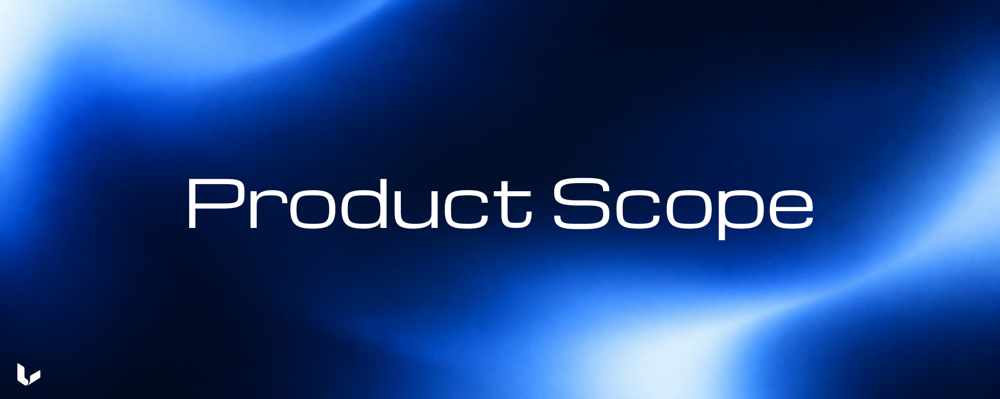

# Product scope

  

Urma retrieves captions and selected frames from finite videos through MCP.
It supports caption search, caption reads, visual overviews, and frame requests
at specific times. The [tool reference](EVIDENCE_MODEL.md) describes those
operations, and the [README](../README.md) covers installation.

## Source admission

### Remote videos

Urma uses yt-dlp to resolve public video URLs. A source must resolve to one
video with a positive, finite duration. Supported media forms include
progressive files, finite HLS playlists, and static DASH timelines.

Compatibility checks cover public fixtures from X / Twitter,
Facebook Reel, Instagram Reel, Loom, Streamable, and Mux-hosted HLS. This is
fixture-based coverage; provider access and delivery formats can change.

Other providers, including YouTube single-video URLs, are best effort. yt-dlp
support by itself does not guarantee that Urma can inspect or retrieve frames
from a source.

Urma rejects live and upcoming streams, playlists and other multi-video
results, private videos, sources requiring login or payment, and DRM-protected
media. Remote URLs must use HTTP or HTTPS on the default port, without embedded
credentials, and pass the [network checks](SECURITY.md#remote-url-and-network-boundary).

### Local videos

Local videos must be regular files inside a directory allowed by
`URMA_LOCAL_ROOTS`. Access is disabled when no roots are configured. Resolved
symlink and junction targets must also remain inside an allowed root.

For a video such as `demo.mp4`, Urma checks for `demo.vtt`, then `demo.srt` in
the same directory. The selected sidecar uses the same access checks as the
video. UNC inputs require `URMA_ALLOW_UNC` as well as an allowed root.

## Captions and visual results

Captions come from the source or a local sidecar. Urma does not transcribe
audio, translate captions, or repair automatic captions. Search performs
literal phrase or term matching in one selected track; it does not use
semantic search.

Overviews contain up to 12 visual samples. Frame requests return JPEGs at
chosen times, as an ordered burst, or as a paged fixed-cadence schedule.
Sampling can miss events between frames. Urma does not run OCR, object or
action recognition, or model-based video analysis.

## Runtime and storage

Urma is designed for a single local user and does not provide hosted multi-user
isolation. Its installation and cache require a user-owned local data directory.
MCP clients control where returned text and images are processed, including
whether they are sent to a model service.

See the [installation requirements](../README.md#requirements) and
[maintenance commands](../README.md#cli-and-maintenance) for supported platforms,
runtime setup, and updates.
